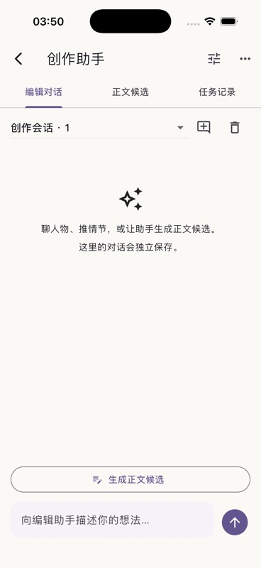

# Agent 与 ST 资源集成验证

2026-10-13：61 个核心测试、7 个 Flutter 流程测试通过，分析器无问题。iPhone 17 / iOS 26.4 模拟器完成原生构建和助手界面检查。未调用收费模型，未在实体手机验证。

测试覆盖编辑回复流式展示与取消、删除会话不修改正文、旧候选禁止覆盖作者新修改、局部选区生成、提示词预览不发起任务、正式请求复用预览快照、采纳后编辑器刷新，以及选区外格式保留。测试发现手机标题栏 6 像素溢出，已修复。

ST 资源测试覆盖加密原件的数据库重开、未知字段保留、普通数据不含凭据、错误密钥无法解密、无效导入不写入，以及归档资源仍可被已有版本绑定使用。资源库提供导入预览、JSON 编辑新版本、JSON 导出及归档；正文配置可选择角色卡、预设顺序组、Persona、文本格式组合、世界书和正则。

原件采用 [cryptography 的 AES-GCM](https://pub.dev/documentation/cryptography/latest/cryptography/AesGcm-class.html)，随机 256 位密钥保存在本机密钥文件中。跨设备备份仍需要后续的密钥/附件迁移流程；不能复制数据库后假定原件可在另一设备解密。JSON 导出会去掉凭据，角色卡附件仍保留在本机加密原件内。

角色卡创建小说及初始资料、旁路提取审阅和分支管理在下一任务接入；本记录不将这些未完成项计入本阶段成果。
