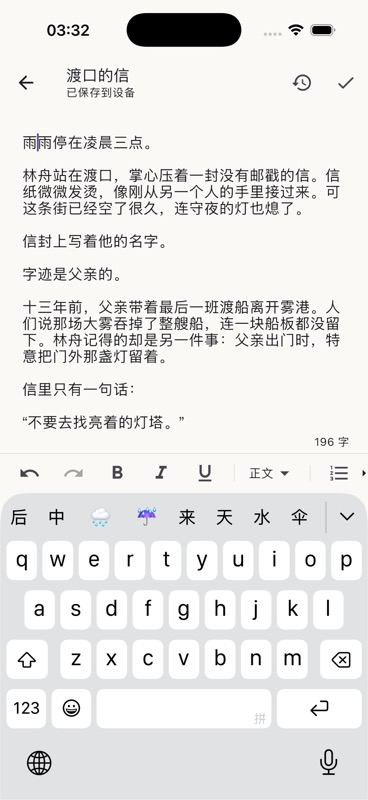
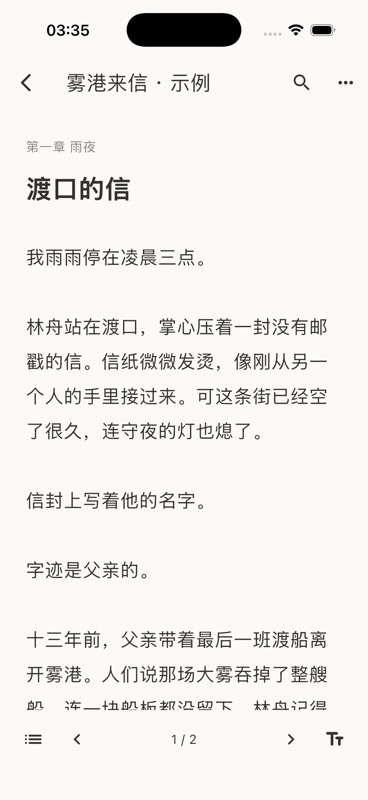

# 编辑与阅读验证

2026-10-13，Flutter 3.47.7 / Dart 3.13.5，macOS arm64 / Xcode 26.4.1。

本阶段验证书架、正文编辑、独立阅读器及模型配置界面。Agent、资料、插画、导出及远程执行仍由后续任务交付。

- 核心包 58 个测试通过，包括真实文件数据库重开、阅读设置和书签持久化。
- Flutter 4 个流程测试通过：390×844 新建作品；1280×900 独立阅读；中文组合输入连续两次自动保存后目录/阅读器刷新；长场景书签位置与阅读进度恢复。
- `flutter analyze` 无问题。
- `flutter build macos --debug` 和 `flutter build ios --simulator --debug` 成功。
- XcodeBuildMCP 在 iPhone 17 / iOS 26.4 模拟器构建并运行。通过系统简体拼音键盘点击 `y`、`u`，再选择“雨”，成功提交组合输入并保存。重启后仍能读到修改，第二次输入后目录字数和独立阅读器即时更新。测试使用本地示例小说，未调用外部模型。
- 系统无障碍快照可定位作品、编辑、保存、历史和阅读操作。书架补充明确的作品按钮语义。完整文字缩放、桌面快捷键和工具栏无障碍检查由平台整合阶段继续覆盖。

验证中发现并修复：Riverpod 3 会合并重复的 void 事件，导致连续写入后的查询缓存失效；变更流改为递增序号，并用两次自动保存回归测试覆盖。书签最初只定位到场景开头，现按实际排版的字符位置定位。测试中文输入时必须保留编辑器原有的最终段落换行符，不能模拟成删除整个文档结构。

本阶段未在 Android、Windows、Linux 上运行；后续平台构建会分别记录结果。模拟器验证不能替代所有实体设备和第三方输入法测试。
