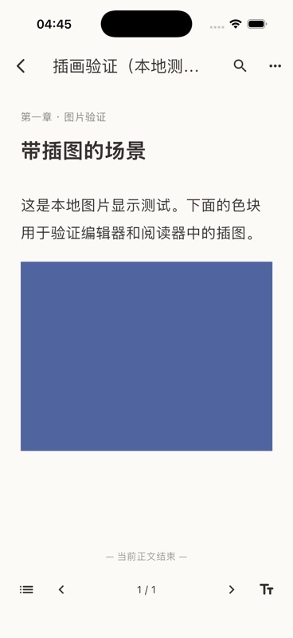
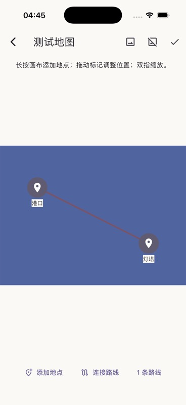

# 插画、参考图与本地资产验证

图片生成使用独立的 Images API 适配器，按 [生成接口](https://developers.openai.com/api/reference/resources/images/methods/generate)发送 JSON，按[图片编辑接口](https://developers.openai.com/api/reference/resources/images/methods/edit)发送包含参考图的 multipart 请求。模型名称和地址由用户配置；不会默认发送 GPT Image 不支持的旧 `response_format` 参数。兼容服务需要时可通过高级参数显式设置。

返回的 Base64 图片经过格式、字节数和像素数检查，在 Dart isolate 中解码和标准化。PNG、JPEG、WebP 静态图片支持最大 32 MB、1600 万像素。资产按内容哈希保存，生成缩略图，记录用途、提示词、模型、参考资产和来源文稿版本。标准化会移除 PNG 角色卡文本块及其他原图元数据。原始角色卡仍由加密资源库保存；PNG 头像和 CHARX 内图片可提取为参考素材，重复提取会复用已有记录。

图片下载使用独立的无凭据客户端。默认只接受生图连接同源地址；外部 HTTPS 下载域名须在生图配置中显式列出。不自动跟随重定向。文件路径由哈希生成，文件名不能指定读取位置，符号链接和损坏文件会被拒绝。

生成、取消、错误和重试使用持久任务记录。重试是新的请求和任务 ID；图片可以继续引用旧的合法正文版本，界面会提示依据已经变化。生成图片不会改写正文，只有作者插入时才创建正文版本。正文插图仅允许引用当前作品的本地资产；插入同样检查并发版本。归档图片不会删除历史正文所需的文件。

核心测试使用真实本地 HTTP 服务器验证 generation/edit 请求、multipart 参考图、Base64、下载凭据隔离、拒绝越界下载、取消和错误。文件与仓库测试验证重启、PNG 元数据移除、路径安全、跨作品引用、历史版本绑定和重试。应用退出前仍在排队的任务也会在重启后成为可重试的中断任务。

Flutter 测试覆盖手机生图表单→持久任务→取消、图片文件→光标插入→保存→独立阅读器，以及图库归档后正文引用保持。没有调用付费或外部生成模型。

2026-10-13 的 iPhone 17 / iOS 26.4 模拟器原生构建和运行成功。使用 [本地 QA 脚本](../../tool/seed_image_fixture.dart)创建了独立、明确标注的测试作品，检查书架封面、阅读器插图，以及地图底图、地点和路线。截图中的纯色块是测试数据，用于验证显示，不能代表模型画质。

底图保持图片比例，坐标和路线使用相同的归一化画布。来源文件与缩略图均保留，归档优先恢复。启动时清理超过一天、没有任何资产记录引用的哈希文件和写入临时文件；归档资产及历史正文所需文件保留，符号链接不跟随。此清理发生在导入和生成任务启动前，文件系统失败会记录诊断并在下次启动重试。项目备份与跨设备同步的资产完整性由转移任务继续验证。
