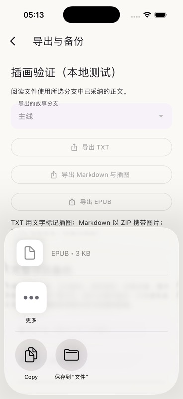

# 作品导出、加密备份与多设备同步

作品菜单中的“导出、备份与同步”提供阅读文件和完整项目备份。书架右上角“导入与同步”可恢复备份或连接已有的远端作品。

## 阅读文件

导出先固定所选分支的已采纳正文快照。编辑会话、其他分支、旁路资料和未采纳候选不进入阅读文件。

| 格式 | 文件内容 |
| --- | --- |
| TXT | 章节标题和正文；插图用带名称的文字标记表示 |
| Markdown | ZIP 中的 `book.md` 与 `assets/` 图片；可解压后继续编辑或发布 |
| EPUB | EPUB 3 容器、目录、阅读顺序、封面、章节 XHTML、样式和本地图片 |

导出保留常见的粗体、斜体、标题、引用、列表与安全链接。EPUB 另保留下划线和删除线；Markdown 的具体显示取决于阅读器。自定义字体、颜色、复杂嵌套布局不是排版等价承诺。文本经过转义，正文中的 HTML 不作为脚本执行。EPUB 连续有序列表放在同一个列表容器中，保持编号连续。

EPUB 结构依据 [W3C EPUB 3.3](https://www.w3.org/TR/epub-33/)。图片实际携带在文件中，不依赖设备路径或外部图片网址。导出上限为未压缩 256 MB；缺失或损坏的插图会明确报错。

## 完整项目备份

`.sillydraft` 是口令加密的项目包，包含一部小说的全部分支、章节、正文历史、提案、生成任务、编辑会话、旁路资料历史、变量、书签、阅读位置、封面和图片。它还包含项目引用的 ST 资源及其父版本和精确原文件；未引用的全局资源库不随某一部小说打包。

模型 API 密钥、全局模型连接、同步认证、本机资源保险库密钥不进入备份。ST 精确原文件本身可能包含导入时的凭据，因此完整项目包始终加密；普通作品分享使用 TXT、Markdown 或 EPUB。

备份使用随机盐、PBKDF2-HMAC-SHA256 600,000 次迭代派生密钥，再使用 AES-256-GCM 认证加密。口令至少 12 个字符；加密和压缩在独立 isolate 执行。文件具有固定版本头，内部清单记录每个成员的大小和 SHA-256。密码处理使用 [cryptography 的 PBKDF2 API](https://pub.dev/documentation/cryptography/latest/cryptography/Pbkdf2-class.html)。口令不随文件保存，遗失后无法恢复。

恢复步骤为：选择文件、输入口令、查看作品和资产数量、恢复为独立作品。恢复副本会生成新的实体标识，并改写结构化引用；正文文字、ST 未知扩展字段和故事变量值保持原值。精确 ST 原文件在目标设备重新使用本机密钥文件中的资源密钥加密，能够跨设备恢复。

解析在内存中完成，不把 ZIP 路径直接解压到文件系统。压缩文件最多 128 MB，展开最多 256 MB，项目 JSON 最多 32 MB。校验清单、路径、重复文件、图片类型和尺寸、ST 原文件哈希、表结构、项目引用与循环后，在独立数据库预检。目标数据库通过单次事务提交；图片预先写入受校验的内容哈希路径。后期失败最多留下可清理的无引用图片，不会留下半部可见小说。

恢复中的排队或运行任务标记为中断，保留部分结果。恢复不重新调用模型。重新生成需要配置目标设备的模型密钥。

## 可选同步

每部作品可配置一个完整的 HTTP / WebDAV 文件地址，保存一个加密备份对象。同步服务必须支持 GET、PUT、强 ETag，以及 `If-Match` / `If-None-Match` 条件写入。协议依据 [RFC 9110 的条件请求](https://www.rfc-editor.org/rfc/rfc9110.html#name-conditional-requests)。客户端不跟随重定向，避免认证被发送至另一个地址；远程默认要求 HTTPS，HTTP 需要显式启用。

认证支持无认证、Basic 用户名密码和 Bearer 令牌。认证与项目同步口令放在本机密钥文件，地址和非敏感选项存入本地设置。更换地址或 Basic 用户名后必须重新填写对应认证。已启用同步的同一地址不能悄悄替换保存的解密口令；改用新口令时应使用新的同步地址，并让其他设备重新连接。

这是按作品进行的主动同步，点击“保存配置并同步”才执行。无需应用账户，不依赖常驻后台执行，也没有自动逐段合并。远端服务需由用户准备；HTTP 集成测试使用本地协议服务器，没有声称验证所有 WebDAV 产品。

- 只有本机修改时，用已知远端 ETag 条件上传。
- 只有远端修改时，下载并在事务内核对本机作品指纹后更新。
- 双方都修改时，本机作品保留，远端完整项目恢复成独立冲突副本。重复看到同一远端版本不会再次建副本。
- 作者可以比较并手动整合，再“保留本机并上传”；只有正在查看的远端版本仍存在时，覆盖才成功。
- 选择“采用远端”时，先保存本机完整冲突副本，再核对本机版本并更新。

同步指纹覆盖正文、版本、分支、资料、任务和引用资源；单独移动阅读位置不触发作品同步冲突。阅读位置仍包含在完整备份中，并可随一次作品更新传递。下载基线与项目更新在同一事务中记录，下载期间的新编辑不能被当作已同步而丢失。

## 验证证据

核心测试使用真实 SQLite 文件和两套不同密钥：恢复后重新打开数据库，核对正文历史、两条分支、伏笔、变量、书签、归档图片、封面和原始 ST 字节；数据库中不存在测试用原始凭据明文。错误口令、密文破坏、跨项目引用及插入记录后的附件验证失败都保持已有作品。

双设备测试覆盖上传、下载、双方并发编辑、冲突副本去重、拒绝覆盖更新的远端、选择本机、选择远端并保留本机副本。HTTP 测试检查条件请求、认证、412 冲突、弱 ETag 和重定向拒绝。Flutter 测试覆盖手机 TXT 导出、恢复预览后新增作品、保留原有小说，以及拒绝意外替换同步口令。

2026-10-13 的 iPhone 17 / iOS 26.4 模拟器构建和运行成功。真实应用从独立的本地 QA 作品导出 EPUB 并打开系统分享面板；已检查实际导出的 [EPUB 测试文件](illustration-fixture.epub) 的 XML、manifest 目标、spine、未压缩首个 mimetype 条目和本地图片。此检查不是 EPUBCheck 全部规则认证。

自动化工具没有暴露系统分享面板“保存到文件”的可操作元素，因此本次原生证据到打开系统面板为止；没有声称自动化完成系统文件保存。文件内容本身已从应用缓存读取并验证。跨桌面平台的系统保存和打包继续由平台任务验证。
